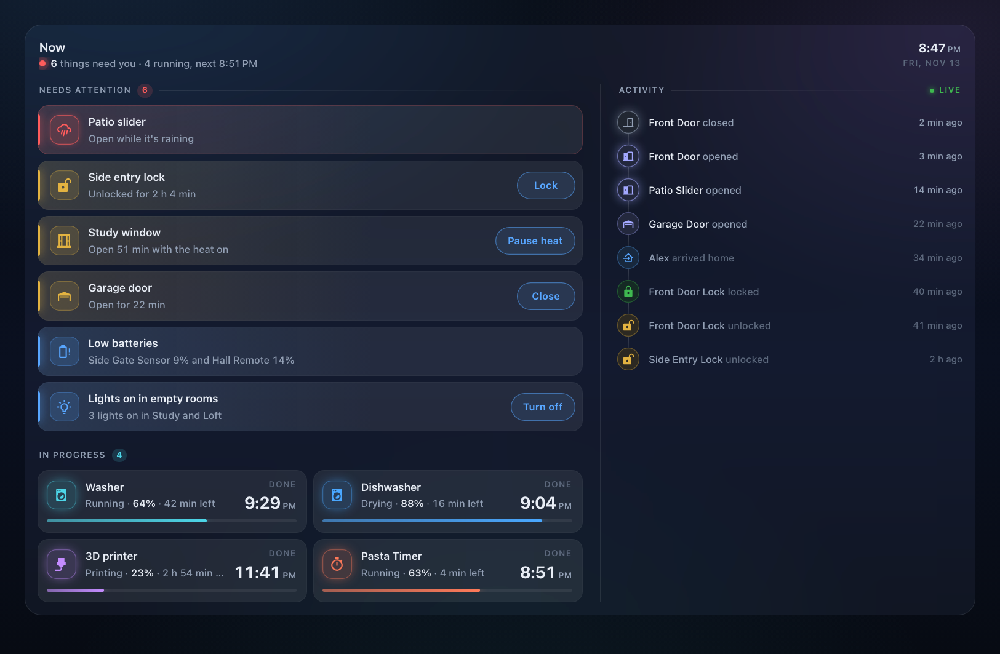

# Glasshouse Now Card

The "Now" panel for the main page of a Home Assistant dashboard. Instead of a wall of tiles it tells you
what matters right now, in three zones: **what needs you** (each with a one-tap fix), **what is
running** (with progress and a done-at time), and **what just happened** (a live timeline). Part of the
**Glasshouse** suite: refined dark glass, one accent per device type, live numbers.



## Features

- **Header** with a one-line summary that reads like a sentence (`3 things need you · 4 running, next
  8:51 PM`, or `All calm`), a status dot in the colour of the most serious item, and a clock.
- **Needs attention**: rules you write in plain config (state equals / not / above / below, held for N
  minutes, with an optional extra condition), plus built-in smart rules: **lights on in empty rooms**,
  **low batteries** and **devices offline**. Each item gets a plain-English line
  (`Unlocked for 2 h`, `3 lights on in Study and Loft`), a severity-coloured accent bar and icon, and an
  optional **fix button** that calls a service, shows a spinner, then a check mark. Fixes can ask for a
  second tap to confirm. Items are sorted by severity, then by how long they have been true.
- **Calm state**: when nothing needs you, a check mark draws itself and the card says
  `Nothing needs you · All 6 checks clear`. On wide cards it becomes a centred panel listing every
  check that passed.
- **In progress**: washers, dishwashers, 3D printers, timers or anything else with a state. A thin
  animated progress bar, the percentage, the time left and a large **done at** time. It understands
  percent-remaining sensors, end-time sensors, remaining-time sensors in any common format, and
  Home Assistant `timer` entities. With only a progress sensor, it estimates the done time from how fast
  the progress is moving (shown with `~`). Unknown progress shows an indeterminate bar. The zone hides
  when nothing is running.
- **Activity**: a vertical timeline of recent events for the entities you choose
  (`Front Door opened · 2 min ago`, `Garage closed`, `Alex arrived home`), with icons and colours per
  domain and state. It streams from Home Assistant's logbook (history first, then live) and refreshes
  the relative times every 30 seconds. Without the logbook it falls back to recording changes it sees.
- **Layout**: from 700 px wide, attention and in-progress sit on the left and activity on the right,
  separated by a hairline; narrower, the zones stack. Running items use two columns when there is room.
- Tap any row for more-info. Sections view ready (`columns: full`, `rows: auto`), phone width (360 px)
  up to wide desktop. Keyboard and screen-reader friendly, respects `prefers-reduced-motion`.
- Forgiving: unknown or garbage states show `—` and never break the card.
- No dependencies, no build step: one JavaScript file.

## Installation

### HACS (custom repository)

1. HACS → ⋮ → **Custom repositories**.
2. Add `https://github.com/petergCA/glasshouse-now-card` with type **Dashboard**.
3. Install **Glasshouse Now Card**, then reload the browser.

### Manual

1. Copy `glasshouse-now-card.js` to `config/www/`.
2. Settings → Dashboards → ⋮ → **Resources** → add `/local/glasshouse-now-card.js` as a
   **JavaScript module**.

For the full look, pair it with the **Glasshouse** theme.

## Configuration

| Option | Type | Default | Description |
|---|---|---|---|
| `type` | string | **required** | `custom:glasshouse-now-card` |
| `title` | string or `false` | `Now` | Header title. `false` hides the header. |
| `clock` | boolean | `true` | Show the clock in the header. |
| `attention` | list | – | Rules for the **Needs attention** zone (below). `[]` shows the calm state only. |
| `calm_message` | string | `All N checks clear` | Second line of the calm state. |
| `running` | list | – | Items for the **In progress** zone (below). |
| `activity` | object or list | – | The **Activity** timeline (below). A plain list of entity ids also works. |

At least one of `attention`, `running` or `activity` is required.

### Attention rules

An entity rule fires while its test is true:

| Option | Type | Default | Description |
|---|---|---|---|
| `entity` | entity | **required** | The entity to watch. Or `entities:` (a list) to watch several with one rule. |
| `when` | string or list | domain default | State equals one of these. Alias `state`. |
| `not` | string or list | – | State is anything except these (unavailable/unknown never match). |
| `above` / `below` | number | – | Numeric tests (can be combined). |
| `for` | minutes | `0` | How long the test must have held (from `last_changed`). Also accepts `"1:30"` or `"90 min"`. |
| `condition` | object or list | – | Extra gate(s): `{entity, state / when / not / above / below}`. All must hold. |
| `name` | string | friendly name | Title of the item. |
| `message` | string | `{state} for {duration}` | Second line. Templates below. |
| `severity` | `alert` / `warn` / `info` | `warn` | Colour and sort order. `alert` pulses. |
| `icon` | string | from the entity | Icon. |
| `fix` | object | – | One-tap fix (below). |
| `id` | string | – | Stable key, if you reorder rules often. |
| `details` | object | – | Tap the item to expand a list built from a list attribute of the (first) entity, instead of opening more-info: `{attribute: entities, name_key: name, sub_keys: [area, since], group_by: integration, max: 15}`. Rows open that entity's more-info. Made for Sensor Sentinel's `sensor.*_unavailable_count`. |

With no `when` / `not` / `above` / `below`, a rule fires on the domain's "active" state: unlocked locks,
open covers, `on` binary sensors and switches, playing media players, triggered alarms, climate not off.

**Templates** in `message`: `{duration}` (how long it has been true: `<1 min`, `42 min`, `2 h 4 min`,
`1 d 3 h`), `{state}` (human state: `open`, `unlocked`, `84.5 °F`), `{name}`, `{count}` and `{names}`
(how many entities fire and their names, `Kitchen, Bath and Study`). The first letter is capitalised.

**Fix** options:

| Option | Type | Description |
|---|---|---|
| `label` | string | Button text. |
| `action` | string | Service, e.g. `lock.lock`. Alias `service`. If left out, a sensible default is used for the entity's domain: locks lock, lights/switches/fans turn off, covers and valves close, media pauses. |
| `target` | entity, list or object | Service target. Defaults to the firing entities when the service's domain matches theirs (or is `homeassistant`); other services (scripts, for example) get no target unless you give one. An object such as `{entity_id: climate.hall}` is merged into the data. |
| `data` | object | Extra service data. |
| `confirm` | boolean | Ask for a second tap ("Confirm") before calling. |

#### Built-in group rules

**`lights_in_empty_rooms`**: lights left on in rooms nobody is in.

| Option | Default | Description |
|---|---|---|
| `rooms` | **required** | List of `{name, lights: [...], occupancy: entity or list, empty_for}`. |
| `empty_for` | `15` | Minutes the room's occupancy sensor(s) must have been off. Per-room override allowed. |
| `severity` | `info` | |
| `fix` | `{label: Turn off}` | Turns off the lit lights in the empty rooms (one call per domain). `fix: false` removes it; an `action` such as `homeassistant.turn_off` gets the lit lights as its target. |
| `message` | `{count} {lights} on in {names}` | Also `{rooms}` (number of rooms) and `{duration}` (shortest time empty). |

A room with no occupancy sensor, or one that is unavailable, is never treated as empty.

**`low_battery`**: `entities` (battery sensors, or battery binary sensors), `below` (default `20`).
Message defaults to the names with their levels (`Gate 9% and Remote 14%`; token `{levels}`).
Severity `info`.

**`unavailable`**: `entities` that have been `unavailable` for `for` minutes (default `10`).
Severity `warn`.

### Running items

| Option | Type | Description |
|---|---|---|
| `name` | string | Display name (defaults to the state entity's friendly name). |
| `icon` | string | Icon. Defaults from the name (washer, dryer, dishwasher, printer, oven, vacuum, timer…) or the entity. |
| `state` | entity | Status entity, shown as text (`Running`, `Drying`, `Printing`). Alias `entity`. A `timer` entity works on its own. |
| `active_when` | string or list | States that mean "running". Default: anything except off, idle, stop, stopped, ready, standby, finished, complete, none, unavailable, unknown, 0 (case-insensitive). |
| `progress` | entity | Number 0–100. |
| `progress_inverted` | boolean | The sensor is percent **remaining**: progress = 100 − value. |
| `end_time` | entity | Timestamp sensor (ISO, epoch or `HH:MM`) for the done-at time. |
| `remaining` | entity | Time left: `h:mm`, `h:mm:ss`, ISO 8601 (`PT42M`), `1h 5m`, or a number in its `unit_of_measurement` (s, min, h, d; minutes if none). |
| `accent` | string | A Glasshouse accent name (`water`, `media`, `heat`, `energy`…) or any CSS colour. Default `fan` (cyan). |

Without a `state` entity, an item counts as running while its progress is between 0 and 100 or time
remains.

### Activity

| Option | Type | Default | Description |
|---|---|---|---|
| `entities` | list | **required** | Entity ids, or objects `{entity, name, icon, states: [...]}`; `states` limits which changes are shown. |
| `max` | number | `8` (`100` with `visible`) | Most events kept. |
| `hours` | number | `12` | How far back to look. |
| `show_time` | boolean | `false` | Show each event's clock time (no date) before its relative age, both in aligned columns. |
| `visible` | number | – | Rows visible at once. The feed keeps that height and scrolls through every event in `hours` (fading at the bottom while more is below). Ignored in the wide split layout, which already fills its column and scrolls. |

Changes to `unavailable` / `unknown` are skipped. Doors, windows, garage doors and covers read as
opened/closed; locks as locked/unlocked; people as arrived home / left home / arrived at a zone; motion,
leak and smoke sensors, lights, switches, alarm panels and media players have their own phrasing.

### Theming

Every design token can be overridden from a theme with a `glasshouse-*` variable, for example
`glasshouse-surface`, `glasshouse-radius`, `glasshouse-text-2`, `glasshouse-alert`, `glasshouse-warn`,
`glasshouse-info`, `glasshouse-accent` (the fix buttons).

## Examples

Minimal:

```yaml
type: custom:glasshouse-now-card
attention:
  - entity: lock.back_door
    when: unlocked
    for: 30
    fix: { label: Lock }
activity: [binary_sensor.front_door, lock.back_door, person.alex]
```

Full:

```yaml
type: custom:glasshouse-now-card
title: Now
attention:
  - entity: lock.garage_entry
    when: unlocked
    for: 30
    name: Garage entry lock
    message: "unlocked for {duration}"
    severity: warn
    icon: mdi:lock-open-variant
    fix: { label: Lock, action: lock.lock }
  - group: lights_in_empty_rooms
    name: Lights on in empty rooms
    empty_for: 15
    fix: { label: Turn off }
    rooms:
      - name: Office
        lights: [light.office_ceiling, switch.office_desk_lamp]
        occupancy: binary_sensor.office_motion
      - name: Loft
        lights: [light.loft]
        occupancy: binary_sensor.stairs_motion
  - entity: binary_sensor.patio_door
    when: "on"
    name: Patio door
    message: "open while it's raining"
    severity: alert
    icon: mdi:weather-pouring
    condition: { entity: sensor.rain_rate, above: 0 }
  - entity: binary_sensor.office_window
    when: "on"
    for: 5
    name: Office window
    message: "open {duration} with the heat on"
    condition: { entity: climate.thermostat, state: heat }
    fix: { label: Pause heat, action: climate.turn_off, target: climate.thermostat }
  - entity: cover.garage_door
    when: open
    for: 15
    fix: { label: Close, confirm: true }
  - group: low_battery
    below: 20
    entities: [sensor.gate_battery, sensor.remote_battery, sensor.leak_sensor_battery]
running:
  - name: Washer
    icon: mdi:washing-machine
    state: sensor.washer_machine_state
    active_when: [run, running]
    progress: sensor.washer_percent_remaining
    progress_inverted: true
    remaining: sensor.washer_time_remaining
  - name: Dishwasher
    state: sensor.dishwasher_status
    progress: sensor.dishwasher_progress
    end_time: sensor.dishwasher_end_time
    accent: water
  - name: 3D printer
    state: sensor.printer_status
    progress: sensor.printer_progress
    remaining: sensor.printer_remaining_time
    accent: media
  - state: timer.kitchen
    accent: heat
activity:
  entities:
    - binary_sensor.front_door
    - cover.garage_door
    - person.alex
    - lock.front_door
    - entity: binary_sensor.hall_motion
      states: ["on"]
  max: 8
  hours: 12
```

## Development

`test/harness.html` renders the card offline with stub `ha-card` / `ha-icon` / `ha-state-icon`
elements and a mock `hass` (`test/mock-hass.js`, generic demo data) whose `connection.subscribeMessage`
fakes the logbook stream. The clock is frozen for repeatable screenshots. Query options:
`?scenario=calm`, `?w=390` (single card at that width), `?preview` (the `docs/preview.png`
composition), `?live` (streams an event and runs a fix), `?t=HH:MM`. `test/shot.sh` takes a headless
Chrome screenshot of it.

`test/now.test.cjs` covers rule evaluation, duration parsing and templating, fix calls (spinner, check
mark, confirm, failure), progress and ETA math, the activity stream and its fallback, and robustness
under jsdom (`npm i jsdom` in a scratch directory, then run it from there with node).
`test/icons.js` is a small Material Design Icons subset built by `test/make-icons.cjs`.

## License

MIT © Peter Gray
